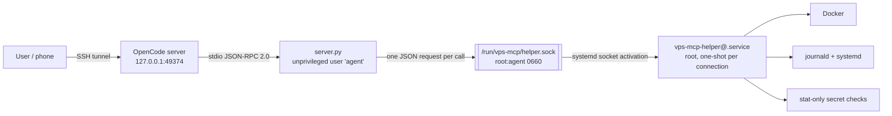

# vps-mcp — read-only MCP diagnostics for a self-hosted VPS

A production MCP (Model Context Protocol) server that gives an AI agent
read-only visibility into a Linux VPS — Docker, systemd/journald, backups,
certificates, firewall, disk, and app reachability — **without sudo, setuid, or
Docker-group membership**.

Built for and deployed on an Oracle Cloud ARM64 box (Ubuntu, 2 vCPU), where the
agent runtime (OpenCode) runs as an unprivileged user with
`NoNewPrivileges=true`. That constraint is the heart of the design: the agent
must be able to *see* the host but never *change* it.

## Architecture



- `server.py` — stdlib-only MCP stdio server. No network listener of its own.
- `helper.py` — root helper with a fixed command allowlist; it accepts no
  arguments, reads exactly one JSON object on stdin, and returns one JSON
  object.
- `systemd/` — a socket unit plus a templated per-connection service.

## Why socket activation instead of sudo

The agent's systemd unit sets `NoNewPrivileges=true`, so `sudo` cannot elevate
from inside it. Instead of weakening that containment, the helper is a systemd
socket-activated service: connections to a root-owned Unix socket spawn a
fresh root oneshot per request. No sudoers entry, no setuid binary, and the
agent process never gains privileges.

## Security model

- Socket is `root:agent`, mode `0660`; only root and the agent user can connect.
- Fixed command dictionary — the request can select **which** read-only command
  runs, never **what** argv is executed. No shell, no eval.
- Container names are validated against `docker ps -a`; unit names must match a
  strict regex; patterns and site names are charset-validated.
- Secret files are only `stat()`ed (mode/owner/mtime) — never read. Restic
  credentials are loaded into the child process environment only and never
  echoed.
- All output is ANSI-stripped, regex-redacted (`password=`, `Bearer`, `?sig=`,
  URL credentials) and bounded in size.
- Every implemented operation is read-only. There is deliberately no mutating
  command.
- Helper service hardening: `NoNewPrivileges`, `ProtectSystem=full`,
  `ProtectHome=read-only`, `PrivateTmp`, `ProtectKernel*`,
  `RestrictSUIDSGID`, `MemoryMax=512M`, `CPUQuota=40%`.

## Tool catalog (14 tools)

| Tool | What it returns |
| --- | --- |
| `vps_overview` | uptime, load, RAM/swap, disk/inodes, docker space, failed units |
| `vps_containers` | every container: image, state, health, restarts, ports, networks |
| `vps_container_logs` | bounded recent logs for one container, redacted |
| `vps_listeners` | TCP listeners; flags public ports outside 22/80/443 |
| `vps_backup_status` | restic timer/service state, journal tail, credential metadata |
| `vps_certs_nginx` | certificate inventory/expiry, `nginx -t`, server_name map |
| `vps_security_status` | UFW, Fail2ban, sshd policy, secret-file metadata, key fingerprints |
| `vps_unit_status` | `systemctl status`/`show` for one unit |
| `vps_journal` | journald entries filtered by unit and/or pattern |
| `vps_disk_usage` | `df` plus bounded `du` totals for data roots |
| `vps_restic_snapshots` | the 10 latest backup snapshots with summaries |
| `vps_nginx_site` | one site's Nginx config, redacted |
| `vps_app_status` | loopback TCP + public HTTPS + TLS days-left per app |
| `vps_docs_read` | read one Markdown file from the synced ops knowledge base |

Plus: `vps-docs://` resources (the ops documentation tree) and two prompts
(`health` — full sweep; `incident` — evidence-first triage). The server
negotiates MCP protocol revisions `2024-11-05` through `2025-11-25`.

## Install (Linux, systemd)

```bash
sudo install -d -o root -g root -m 0755 /opt/vps-mcp /run/vps-mcp
sudo install -o root -g root -m 0644 server.py /opt/vps-mcp/server.py
sudo install -o root -g root -m 0755 helper.py /usr/local/sbin/vps-mcp-helper
sudo install -o root -g root -m 0644 systemd/vps-mcp-helper.socket /etc/systemd/system/
sudo install -o root -g root -m 0644 systemd/vps-mcp-helper@.service /etc/systemd/system/
sudo systemctl daemon-reload
sudo systemctl enable --now vps-mcp-helper.socket
```

Adjust `SocketGroup=agent` in the socket unit to your unprivileged agent user,
and `Documentation=` paths as needed.

Register the server with any MCP client over stdio. Example (OpenCode):

```json
{
  "mcp": {
    "servers": {
      "vps": {
        "type": "local",
        "command": ["/usr/bin/python3", "/opt/vps-mcp/server.py"],
        "cwd": "/home/ops"
      }
    }
  }
}
```

### Configuration

Both Python files are standard-library only — no venv, no packages.

| Env var | Default | Purpose |
| --- | --- | --- |
| `VPS_MCP_HELPER_SOCKET` | `/run/vps-mcp/helper.sock` | helper Unix socket path |
| `VPS_MCP_DOCS_ROOT` | `/home/ops/vps-docs` | Markdown docs tree served as resources |

## Verify

```bash
# socket ownership/mode
sudo ls -l /run/vps-mcp/helper.sock        # srw-rw---- root agent

# one request as the agent user over the socket
printf '{"command":"overview"}' | sudo -u agent -H python3 -c '
import socket,sys
s=socket.socket(socket.AF_UNIX,socket.SOCK_STREAM); s.connect("/run/vps-mcp/helper.sock")
s.sendall(sys.stdin.buffer.read()); s.shutdown(socket.SHUT_WR)
print(s.makefile().read()[:200])'

# full stdio smoke test
printf '%s\n' \
  '{"jsonrpc":"2.0","id":1,"method":"initialize","params":{"protocolVersion":"2025-06-18"}}' \
  '{"jsonrpc":"2.0","id":2,"method":"tools/list"}' \
  | python3 /opt/vps-mcp/server.py
```

## Testing

```bash
python3 -m py_compile server.py helper.py
pip install pytest
pytest -q
```

The test suite covers redaction, input validation, and a full stdio integration
test that spawns `server.py` against a fake helper socket and a temporary docs
root — no root and no real host state required. CI runs it on Python 3.11/3.12.

## Design decisions

- **Read-only by construction.** No mutating command exists anywhere; the
  agent cannot be talked into a restart even if the model is compromised.
- **Privilege separation over sudo.** `NoNewPrivileges` stays intact; the
  privilege boundary is a 0660 Unix socket, each connection a fresh oneshot.
- **Bounded, redacted output.** Secrets never leave the helper; output size is
  capped so a chatty log cannot blow up the agent context.
- **Stdlib-only runtime.** Zero dependency surface on a production host; pytest
  is a dev/CI-only dependency.

## License

MIT — see [LICENSE](LICENSE).
